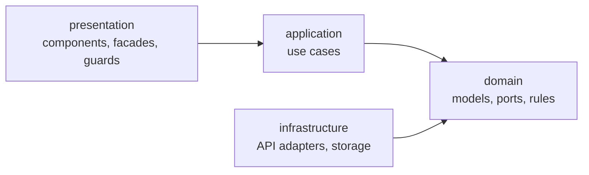
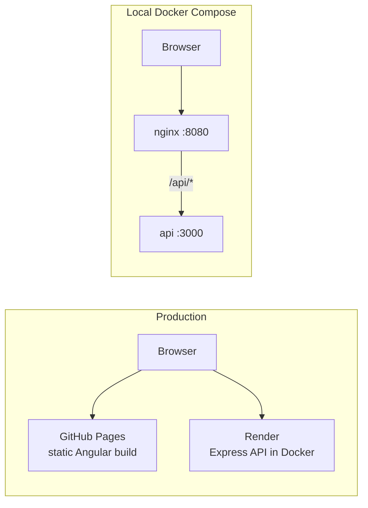

# Architecture

## Overview
Single-page Angular app plus a small Express API. The frontend follows Clean Architecture:
business logic lives in plain TypeScript, framework code stays at the edges.

Dependencies point inward. The domain knows nothing about Angular, HTTP or the UI.

## Layers

| Layer | Folder | Contains | Depends on |
|-------|--------|----------|------------|
| Domain | `src/app/domain/` | Models, enums, ports (`*Repository`, `*Gateway`), validation engine, pure rules | nothing |
| Application | `src/app/application/` | Use cases – one class per user action | domain |
| Infrastructure | `src/app/infrastructure/` | `*Adapter` classes implementing the ports over HTTP / storage | domain |
| Presentation | `src/app/presentation/` | Routed components, presentational components, `*.facade.ts`, guards, interceptors | application, domain |

Ports are bound to adapters in `src/app/infrastructure/index.ts` (`infrastructureProviders`),
which `app.config.ts` registers as the composition root.

**Why:** the domain and use cases are tested without Angular (no TestBed), and the backend
can be replaced without touching business logic. Ports return `Promise` instead of
`Observable` so the inner layers carry no RxJS dependency.

## Domain model

- **`FormModel` is an aggregate root.** Pages, fields and validators are stored embedded in
  the form document, because the form is always read and saved as a whole.
- **`FormSubmissionModel` is a separate collection** with a `formId` reference: different
  lifecycle, high volume, queried independently (by form, by user).
- Nested items (pages, fields, validators) carry a client-generated `id` so they can be
  tracked in the UI, referenced by cross-field validators and regenerated when a form is cloned.
- **Form status** is stored as `Draft | Published`. "Locked" is derived: a form with
  submissions cannot change its structure, but can still be published or unpublished.

## Authorization (RBAC)

Roles map to permissions in `domain/user/` (`ROLE_PERMISSIONS`).

| Action | Admin | Editor | Viewer |
|--------|:-----:|:------:|:------:|
| See form list | yes | yes | published forms only |
| Create / edit / clone / publish | yes | yes | no |
| Delete form | yes | no | no |
| Fill a form | yes | yes | yes |
| View submissions | yes | yes | own only |
| Manage users | yes | no | no |

The same matrix is enforced on the client (route guards, hidden actions) and on the server.

## Backend (`server/`)

Express with ES modules. `app.js` builds the app (used by `index.js` and by the tests).

- `routes/auth.js` – login, register, refresh, profile. Access token (1 h) in the response
  body, refresh token (7 d) in an httpOnly cookie.
- `routes/forms.js`, `routes/submissions.js` – every route requires a valid token (401)
  and one permission (403); business rules return 409 / 422.
- `permissions.js`, `rules.js` – JS copies of the domain's permission map and rules.
  The server image is built from `server/` alone, so it cannot import the Angular domain.
- Storage: a JSON file through lowdb.

## Runtime topology

- **Production:** two origins, so the API uses CORS and a `SameSite=None; Secure` refresh cookie.
- **Docker Compose:** nginx serves the app and proxies `/api/` to the API – one origin,
  no CORS, and the API has no published port.

## Known trade-offs
- Permissions and rules exist twice (client and server); change both together.
- The server does not re-validate answers against field validators.
- Roles are read from the access token, so a role change applies after the next refresh.